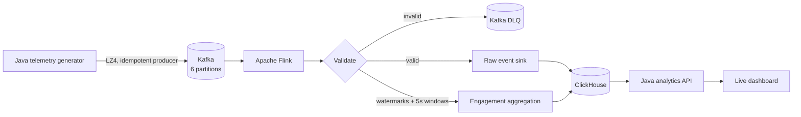

# PulseDrop

PulseDrop is a production-style real-time streaming analytics platform for video playback telemetry. A Java event producer publishes realistic viewer sessions to Kafka; Apache Flink validates and aggregates them in event time; ClickHouse stores raw and five-second windowed data; and a small Java API serves a live analytics dashboard.

The project is self-contained and runs with Docker Compose.

## Architecture



### Data flow

1. The generator publishes `PLAY`, `HEARTBEAT`, `PAUSE`, `SEEK`, `QUALITY_CHANGE`, `REBUFFER`, `COMPLETE`, and `ERROR` telemetry keyed by content ID.
2. Flink consumes six Kafka partitions, sends malformed payloads to `playback-events-dlq`, and assigns bounded-out-of-order event-time watermarks.
3. Valid events are written in configurable batches to `playback_events` while five-second tumbling windows calculate viewer, session, watch-time, buffer, bitrate, engagement, rebuffer, and error metrics.
4. ClickHouse uses `ReplacingMergeTree` event keys to make replayed writes idempotent. Raw events expire after 7 days and aggregate windows after 30 days.
5. The API queries ClickHouse and serves both JSON endpoints and the responsive dashboard.

## Quick start

Requirements: Docker Desktop or Docker Engine with Compose v2. Allocate at least 4 GB of memory to Docker.

```bash
cp .env.example .env
docker compose up --build -d
```

The default profile continuously generates 5,000 events/sec. Startup can take about a minute on the first run while images and Maven dependencies are downloaded.

Open:

- dashboard and API: [http://localhost:8080](http://localhost:8080)
- Flink job console: [http://localhost:8081](http://localhost:8081)
- ClickHouse HTTP interface: [http://localhost:8123](http://localhost:8123)
- Kafka external listener: `localhost:9094`

Check the application:

```bash
./scripts/smoke-test.sh
docker compose ps
docker compose logs -f --tail=150
```

Stop services while retaining data with `docker compose down`. To remove the project containers and local data volumes, use `docker compose down --volumes --remove-orphans`.

## Dashboard and API

The dashboard refreshes every five seconds and shows current event rate, active viewers, average buffering, error and rebuffer ratios, query latency, event/viewer time series, and content-level engagement.

| Method | Endpoint | Purpose |
| --- | --- | --- |
| `GET` | `/health` | Verifies that both analytics tables are available |
| `GET` | `/api/v1/overview` | Current rate, viewers, buffering, errors, and query latency |
| `GET` | `/api/v1/content` | Top content with engagement and error metrics |
| `GET` | `/api/v1/timeseries` | Ten-second event, viewer, rebuffer, and error buckets |

Example:

```bash
curl --fail http://localhost:8080/api/v1/overview
```

## Reliability and data correctness

- Kafka uses KRaft mode, six input partitions, `acks=all`, producer idempotence, LZ4 compression, and 128 KiB batches.
- Flink uses exactly-once Kafka checkpoints every ten seconds, a three-second out-of-order allowance, ten seconds of allowed lateness, and a three-attempt fixed-delay restart strategy.
- Checkpoints are stored in a Docker volume instead of Flink's size-limited in-memory checkpoint store.
- ClickHouse writes are flushed at every checkpoint. Stable event IDs and `ReplacingMergeTree` provide idempotent results when a task replays records after a failure.
- Invalid JSON and domain-invalid records are preserved in the Kafka dead-letter topic with an error reason and ingestion timestamp.
- Health checks and dependency conditions prevent the job from starting before Kafka, ClickHouse, Flink, and schema initialization are ready.

## Configuration

Copy `.env.example` to `.env` and override any of these values:

| Variable | Default | Description |
| --- | ---: | --- |
| `EVENTS_PER_SECOND` | `5000` | Continuous demo generator target |
| `GENERATOR_DURATION_SECONDS` | `0` | Generator duration; `0` runs continuously |
| `FLINK_PARALLELISM` | `2` | Source, sink, and aggregation parallelism |
| `CLICKHOUSE_BATCH_SIZE` | `1000` | Rows per JDBC batch |
| `CLICKHOUSE_FLUSH_MS` | `1000` | Maximum wait before a partial batch is flushed |

Set `GENERATOR_SEED` only when deterministic generated data is useful for a test; normal runs choose a unique seed so event IDs remain restart-safe.

## Build and test

Java 17 and Maven 3.9+ can be used for local development:

```bash
mvn clean verify
java -jar target/pulsedrop.jar help
```

Convenience targets are also available:

```bash
make test
make up
make smoke
make benchmark
make down
```

The unit tests cover telemetry validation, JSON round trips, and windowed metric aggregation. GitHub Actions runs `mvn verify` and validates the Compose model for changes under `pulsedrop/`.

## Reproducible benchmark

Start the stack, then run:

```bash
./scripts/benchmark.sh 30000 20
```

The script records the starting ClickHouse row count, runs an isolated bounded generator, waits for every new event to reach ClickHouse, fails if ingestion does not catch up within three minutes, and measures P95 latency over 20 API queries.

### Validation report — August 19, 2026

| Measurement | Observed result |
| --- | ---: |
| Target producer rate | 30,000 events/sec |
| Load window | 20 seconds |
| Generated events | 600,000 |
| Stored unique events | 600,000 |
| End-to-end catch-up time | 32 seconds |
| Overview API query latency | 41.7 ms P95 |
| Checkpoints after validation | 37 completed, 0 failed |
| Latest checkpoint | 12.49 MB in 74 ms |
| Final validation dataset | 1,200,000 rows / 1,200,000 unique event IDs |


## Project structure

```text
pulsedrop/
├── clickhouse-init/          ClickHouse tables, view, and retention rules
├── scripts/                  Smoke and reproducible benchmark commands
├── src/main/java/            Pipeline, models, serializers, sinks, API, generator
├── src/main/resources/       Browser dashboard
├── src/test/java/            JUnit tests
├── docker-compose.yml        Kafka, ClickHouse, Flink, API, and generator
├── Dockerfile                Reproducible multi-stage Java/Flink images
├── Makefile                  Common development commands
└── pom.xml                   Java 17 build and dependency versions
```

## Implementation status

- [x] partitioned Kafka ingestion and dead-letter topic
- [x] schema/domain validation and event-time watermarks
- [x] five-second playback engagement aggregates
- [x] batched idempotent ClickHouse persistence and retention
- [x] filesystem-backed checkpoints and restart policy
- [x] analytics REST API and live dashboard
- [x] deterministic unit tests, smoke test, and load benchmark
- [x] Docker health checks, persistent volumes, and CI
